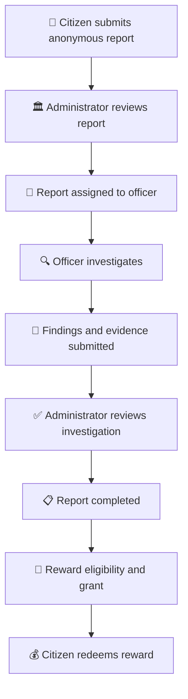

# 🛡️ NashaMukt
### 🌱 Anonymous Drug Activity Reporting & Investigation Platform

<p align="center">
  <strong>Building a safer, drug-free society through technology.</strong>
</p>

<p align="center">
  
  
  
  
  
  
</p>

---

## 🌟 About the Project

**NashaMukt** is a web-based platform designed to help citizens anonymously report suspected drug-related activities and help authorities manage, investigate, and resolve reports efficiently.

It connects citizens, government administrators, and local officers through a centralized reporting and investigation system.

🎯 **Our Mission:** Use technology to encourage community participation, support responsible reporting, and help build safer communities.

---

## ✨ Key Features

### 👤 Citizen Portal
- 📝 Submit anonymous reports.
- 📍 Share location coordinates with reports.
- 🔎 Track report progress using a unique tracking reference.
- 📊 View investigation status.
- 🎁 Check reward eligibility and payment status.
- 💳 Redeem an issued reward code.

### 🏛️ Government Admin Portal
- 🔐 Secure administrator login.
- 📋 View and manage submitted reports.
- 👮 Assign reports to local officers.
- 📈 Monitor investigation progress.
- 📂 Review investigation findings and evidence.
- ✅ Approve, reject, or mark investigations inconclusive.
- 🎁 Configure and grant rewards.
- 💰 View reward and payout records.

### 👮 Local Officer Portal
- 🔐 Secure officer login.
- 📌 View assigned investigations.
- 📝 Update investigation status.
- 📍 Submit investigation GPS coordinates.
- 📎 Upload supporting evidence.
- 📑 Submit investigation findings.

### 💰 Reward Management
- ⚙️ Configure reward amounts.
- 🎯 Grant rewards to eligible reports.
- 🔑 Generate unique reward codes.
- 💳 Allow citizens to redeem issued codes.
- 📊 Track payout and payment status.

---

## 🛠️ Technology Stack

| Category | Technology |
|---|---|
| 🎨 Frontend | Next.js, React, TypeScript |
| 💅 Styling | Tailwind CSS |
| ⚡ Backend | Python, FastAPI |
| 🗄️ Database | PostgreSQL |
| 🔗 ORM | SQLAlchemy |
| 🔐 Authentication | JWT |
| 📖 API Documentation | Swagger / OpenAPI |
| 💸 Payment Integration | RazorpayX |

---

## 📁 Project Structure

```text
NashaMukt/
│
├── 📂 backend/
│   ├── 📂 app/
│   │   ├── main.py
│   │   ├── routes.py
│   │   ├── models.py
│   │   ├── config.py
│   │   └── ...
│   ├── 📂 migrations/
│   ├── requirements.txt
│   └── .env
│
├── 📂 frontend/
│   ├── 📂 src/
│   │   └── 📂 app/
│   ├── 📂 public/
│   ├── package.json
│   └── ...
│
├── .gitignore
└── README.md
```

---

## 🚀 Getting Started

Follow these steps to run NashaMukt locally.

### 1️⃣ Clone the Repository

```bash
git clone YOUR_GITHUB_REPOSITORY_URL
cd nasha_shado
```

### 2️⃣ Backend Setup

```bash
cd backend

python3 -m venv .venv

source .venv/bin/activate

pip install -r requirements.txt
```

### 3️⃣ Environment Configuration

Create a `.env` file inside the `backend` directory.

```env
APP_NAME=NashaMukt
DEBUG=True

DATABASE_URL=your_postgresql_database_url

JWT_SECRET_KEY=your_secure_secret_key
JWT_ALGORITHM=HS256
ACCESS_TOKEN_EXPIRE_MINUTES=30

FRONTEND_URL=http://localhost:3000
```

Add any other payment-provider variables required by your backend configuration.

> ⚠️ Never upload your `.env` file, database password, JWT secret, or payment credentials to GitHub.

### 4️⃣ Database Setup

- Install and start PostgreSQL.
- Create a database for the project.
- Configure `DATABASE_URL` in `backend/.env`.
- Apply migrations if your Alembic configuration is available:

```bash
alembic upgrade head
```

### 5️⃣ Start the Backend

From the `backend` directory:

```bash
uvicorn app.main:app --reload
```

🌐 Backend: http://127.0.0.1:8000

📖 API Documentation: http://127.0.0.1:8000/docs

### 6️⃣ Frontend Setup

Open another terminal:

```bash
cd frontend

npm install

npm run dev
```

🌐 Frontend: http://localhost:3000

---

## 🔄 How It Works



---

## 🔐 Security & Privacy

- 🕵️ Anonymous citizen reporting.
- 🔑 JWT-based authentication.
- 🛡️ Role-based access for administrators and officers.
- 🔒 Protected investigation evidence.
- ⚙️ Secure backend environment configuration.
- 💳 Secure handling of reward and payment operations.

---

## 🔮 Future Enhancements

- 🔗 Secure private tracking links.
- 📱 QR-code-based report tracking.
- 🔔 Real-time investigation notifications.
- 📊 Advanced analytics and dashboards.
- 🧾 Enhanced evidence verification.
- 🔐 Multi-factor authentication and audit logging.
- ☁️ Production deployment and monitoring.

---

## 🤝 Contributing

Contributions are welcome!

1. Fork the repository.
2. Create a feature branch.
3. Make your changes.
4. Commit your changes.
5. Submit a pull request.

---

## ❤️ Our Vision

NashaMukt aims to encourage safer communities by providing an accessible way to report suspected drug-related activities while supporting transparent investigation workflows.

<p align="center">
  <strong>🌱 Together for a Drug-Free Society 🌱</strong>
</p>

<p align="center">
  🛡️ <strong>NashaMukt — Report Responsibly. Build a Safer Tomorrow.</strong>
</p>


